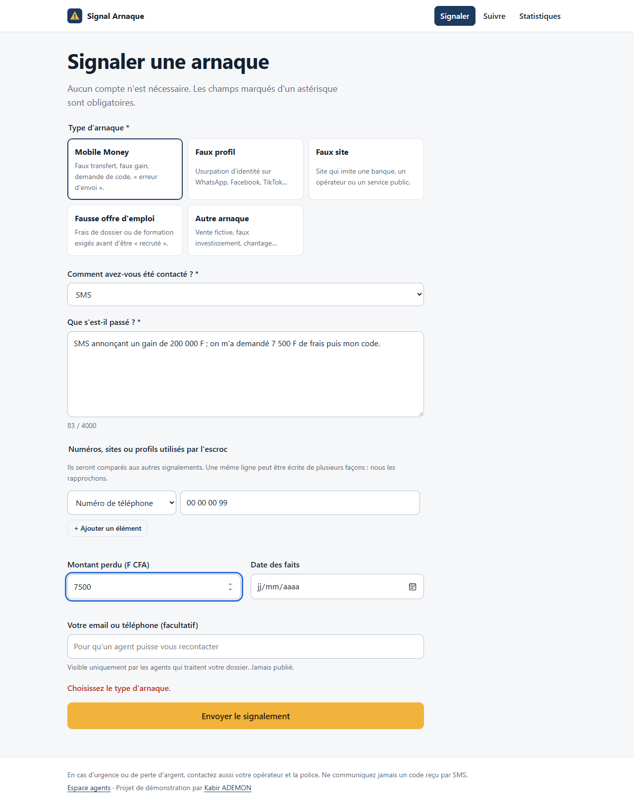
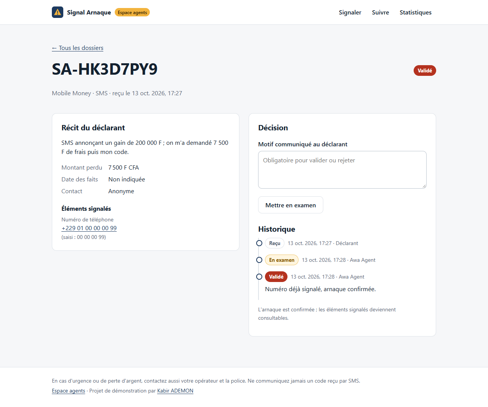
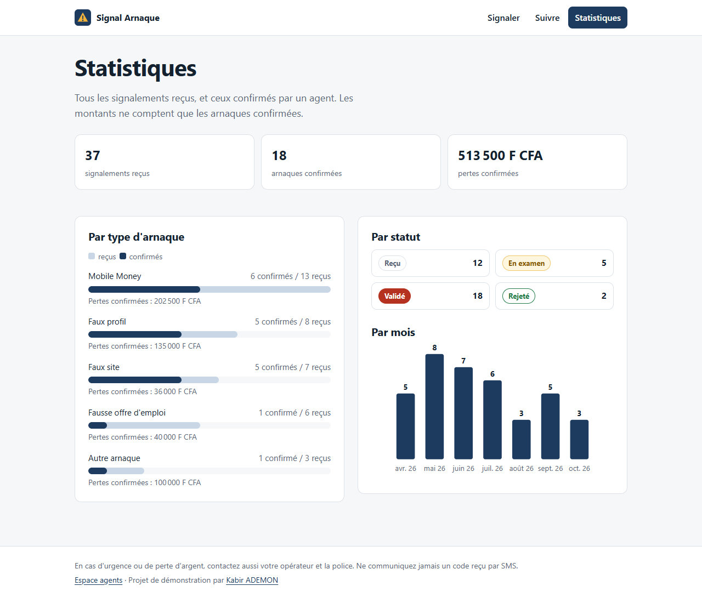

# Signal Arnaque

**Plateforme de signalement des arnaques en ligne : Mobile Money, faux profils, faux sites, fausses offres d'emploi.**

Un citoyen signale une fraude en quelques minutes, sans créer de compte, et suit son dossier avec
une référence et un code. Des agents examinent chaque signalement. Une fois l'arnaque confirmée,
le numéro, le site ou le profil utilisé devient consultable : n'importe qui peut **vérifier avant de payer**.

FastAPI · PostgreSQL · SQLAlchemy 2 · Alembic · React · Vite


> Projet de démonstration. Les données d'exemple sont fictives : numéros `+229 01 00 00 00 xx`
> et sites en `.example`, une extension réservée qui ne désigne personne.

## Ce que fait la plateforme

**Pour le public**
- **Signaler** : type d'arnaque, canal (WhatsApp, SMS, appel…), récit, montant perdu, date, et les numéros,
  sites ou profils utilisés par l'escroc. Contact facultatif, visible des seuls agents.
- **Suivre** son dossier avec sa référence (`SA-7K3QM9XP`) et son code de suivi : statut, historique et motif de la décision.
- **Vérifier** un numéro, un site ou un profil : combien de signalements **confirmés** le citent.
- **Statistiques** : signalements reçus et confirmés par type, par statut et par mois ; pertes confirmées.

**Pour les agents**
- Liste des dossiers avec filtres (statut, type) et recherche (référence, numéro, site, mot du récit).
- Instruction : `reçu → en examen → validé ou rejeté`, avec motif obligatoire pour toute décision,
  et historique de qui a fait quoi. Une décision peut être revue, jamais effacée.
- Administration des comptes agents (rôle administrateur).

| Signaler | Instruire un dossier | Statistiques |
|---|---|---|
|  |  |  |

## Choix de conception

- **Un même escroc, plusieurs écritures.** `97 12 34 56`, `+229 01 97 12 34 56` et `0022997123456` désignent
  la même ligne (les numéros béninois sont passés de 8 à 10 chiffres fin 2024). Chaque numéro, site ou profil est
  stocké sous une forme normalisée, ce qui relie les signalements entre eux.
- **Ne pas accuser à tort.** La vérification publique ne compte que les signalements **validés par un agent** :
  un signalement isolé ou malveillant ne suffit pas à désigner quelqu'un.
- **Le code de suivi n'est jamais stocké en clair** (haché avec scrypt, comme les mots de passe). La réponse est
  identique pour une référence inconnue et un mauvais code : on ne peut pas deviner les dossiers existants.
- **Le contact du déclarant reste privé** : visible des agents, jamais du public ni de l'API publique.
- **Références lisibles au téléphone** : sans `0/O` ni `1/I/L`.

## Sécurité

Chaque protection ci-dessous est couverte par un test qui rejoue l'attaque (`tests/test_securite.py`).

- **Clé de signature obligatoire** : sans `JWT_SECRET` de 32 caractères au moins, le serveur refuse de démarrer.
  Avec la clé de développement, publique dans ce dépôt, n'importe qui pourrait fabriquer un jeton d'administrateur.
- **Limites non contournables** : 5 signalements / 10 min, 10 connexions / 10 min, 30 vérifications / min par visiteur.
  L'en-tête `X-Forwarded-For`, que le client peut inventer, est ignoré ; derrière un proxy de confiance
  (`TRUST_PROXY=true`), seule la dernière adresse, écrite par le proxy, est prise en compte.
- **Blocage par compte** : après 5 échecs de connexion sur un même compte, quelle que soit l'adresse d'origine,
  les tentatives sont refusées pendant 15 minutes.
- **Mots de passe et codes de suivi** hachés avec scrypt (N = 2^15, sel aléatoire, paramètres stockés avec
  l'empreinte pour pouvoir les durcir) ; comparaison en temps constant ; même message et même temps de calcul
  que l'email existe ou non.
- **En-têtes** : CSP stricte (aucun script ni style externe ou intégré), HSTS, interdiction d'intégration dans un cadre,
  `nosniff`, réponses d'API non mises en cache. Requêtes de plus de 64 Ko refusées.
- **Surface réduite** : documentation de l'API masquée en production (`API_DOCS=true` pour l'afficher),
  aucune autorisation CORS, contraintes en base en plus de la validation de l'API.
- Le code de suivi passe dans le corps d'une requête POST, jamais dans une adresse qui finirait dans les journaux.
- Dépendances surveillées par Dependabot ; `pip-audit` et `npm audit` sans faille connue au 13 octobre 2026.

## Lancer en local

Prérequis : Python 3.10+, Node 20+. **Aucun PostgreSQL à installer** : en développement, le projet utilise
[pgserver](https://github.com/orm011/pgserver), qui embarque PostgreSQL sans droits administrateur.

```bash
# Front
cd frontend
npm install
npm run build

# API + base locale + données de démonstration
cd ../backend
python -m venv .venv
.venv\Scripts\activate            # Linux/macOS : source .venv/bin/activate
pip install -r requirements-dev.txt
python dev.py demo --neuf
```

Ouvrir http://127.0.0.1:8000. Espace agents : `agent@demo.bj` ou `admin@demo.bj`, mot de passe `demo-signal-2026`.
La documentation de l'API est sur http://127.0.0.1:8000/api/docs.

Pour développer le front avec rechargement à chaud : `npm run dev` dans `frontend/` (l'API reste sur le port 8000).

**En production** : définir `DATABASE_URL` et `JWT_SECRET` (voir `backend/.env.example` ; générer la clé avec
`python -c "import secrets; print(secrets.token_urlsafe(48))"`), servir en HTTPS, puis
`alembic upgrade head`, puis `python -m app.cli creer-admin email@exemple.bj "Nom"` pour le premier compte.

## Tests

```bash
cd backend
pytest
```

**48 tests sur un vrai PostgreSQL** (pgserver en local, service PostgreSQL 16 sur GitHub Actions). Le schéma est créé
par les **migrations Alembic**, comme en production. Ils couvrent la normalisation des numéros, la validation des
données, le suivi, la vérification, les statistiques, la connexion, le circuit d'instruction, les rôles, les limites
et les protections de sécurité.

**Parcours complet dans un navigateur** (`e2e/parcours.cjs`, Playwright) : un citoyen signale, suit son dossier avec
un mauvais puis le bon code ; un agent se connecte, tente de valider sans motif (refusé), valide ; un autre citoyen
vérifie le numéro écrit autrement et reçoit l'alerte. Il vérifie aussi l'absence d'erreur JavaScript et de
défilement horizontal sur téléphone. Les captures de ce README en sont issues.

## Structure

```
backend/
  app/
    models.py      tables : signalements, éléments signalés, historique, agents
    services.py    règles métier : circuit des statuts, vérification, statistiques
    routers.py     API publique et espace agents
    normalize.py   numéros, sites et profils sous une forme comparable
    security.py    scrypt, jetons, références, limitation des requêtes
  alembic/         migrations
  tests/           tests pytest (PostgreSQL)
  dev.py, seed.py  base locale et données de démonstration
frontend/src/
  pages/           accueil, signaler, suivi, statistiques, espace agents
e2e/parcours.cjs   parcours complet dans un navigateur
```

## Pistes

- Relier la vérification à [vigilien](https://github.com/kabirADEMON/vigilien) pour noter automatiquement le risque des liens signalés.
- Pièces jointes (captures d'écran des messages), avec contrôle du type et de la taille.
- Export des statistiques pour les opérateurs et les autorités.

## Licence

MIT. Auteur : [Kabir ADEMON](https://portfolio-six-opal-16.vercel.app).
